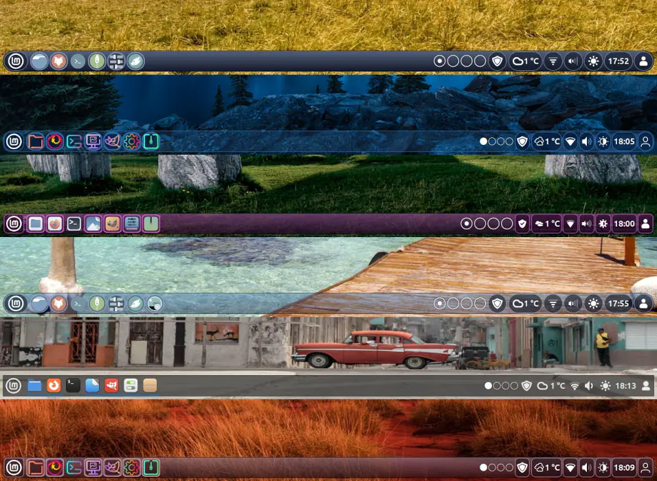
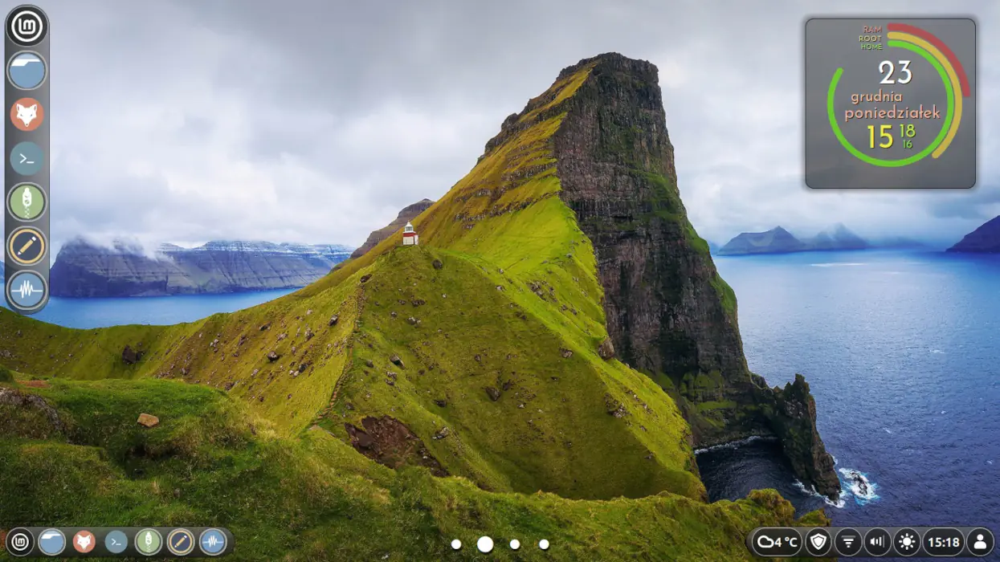

# Floating Panels
#### DESCRIPTION:

An extension that modifies your panel. Tested on Linux Mint 22.3
#

#### KNOWN ISSUES:

The applets “Grouped window list” and “Workspace switcher” have a issue with this extension. Install the modified versions.
#

#### INSTALLATION:

Copy to this location:
~/.local/share/cinnamon
#

#### TIPS:

60 is the maximum height the panel can be set to. To increase it, enter the following command in the terminal:
```bash
sudo sed -i "s/maxi=../maxi=80/g" "/usr/share/cinnamon/cinnamon-settings/modules/cs_panel.py"
```


